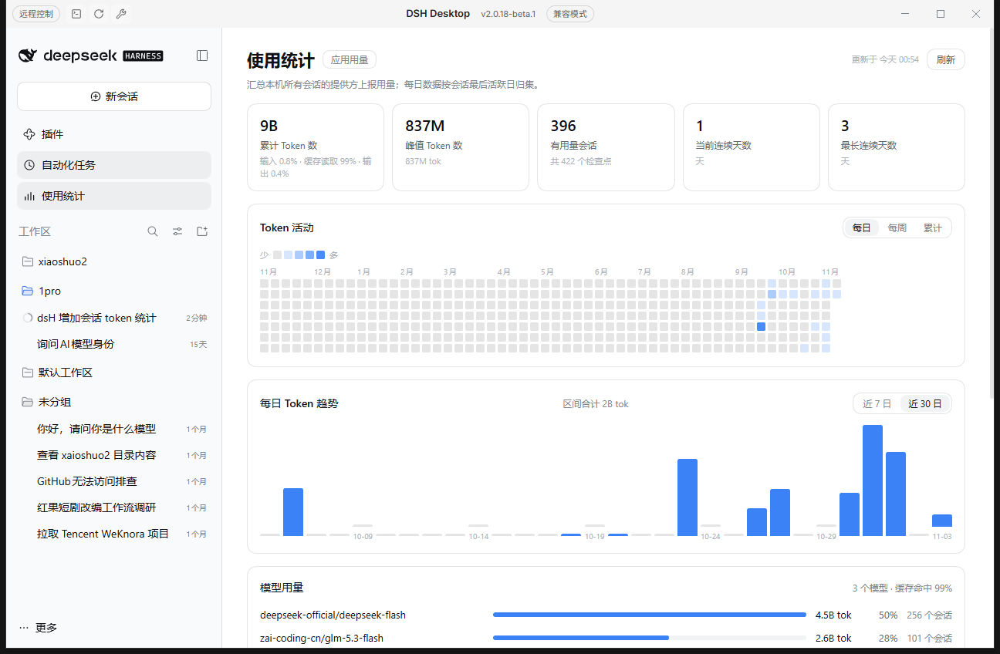

# DSH Token Usage

Two small, local-first plugins for [DeepSeek Harness (DSH)](https://github.com/deepseek-ai/deepseek-harness) that make token usage visible:

| Plugin | Where it appears | What it shows |
|---|---|---|
| [`dsh-usage-stats`](packages/dsh-usage-stats) | Sidebar → **Usage Statistics** page | All-session token totals, peak session, usage streaks, 53-week activity heatmap, 7/30-day trend, per-model usage and a session ranking |
| [`dsh-session-token-stats`](packages/dsh-session-token-stats) | Composer dock → **Token usage** pill | The current session's token total; expanding it shows uncached input, cache read, cache write, output and the cache-hit share |



## Install

Requires DSH `>=0.2.1-rc.1 <0.3.0` (Web / Desktop) and Node `>=22.19`.

The two plugins are separate bundles — install either one or both:

```bash
# all-session usage dashboard (sidebar page)
dsh plugin --profile desktop add "github:inezmitche46-maker/dsh-usage-stats#path:/packages/dsh-usage-stats"

# session token pill in the composer
dsh plugin --profile desktop add "github:inezmitche46-maker/dsh-usage-stats#path:/packages/dsh-session-token-stats"
```

Use `--profile web` on a Web profile. To pin a reproducible revision, replace the branch with a commit hash: `github:inezmitche46-maker/dsh-usage-stats#<sha>&path:/packages/dsh-usage-stats`.

After installing, restart DSH Desktop (or reload the Web page). `dsh plugin add` records each package in the profile's `dsh.profile.bundles`, and the package's own `cordis.patch.yml` inserts its plugin row.

## Data and privacy

- **Read-only.** The dashboard's Host half reads the profile's session projection cache:
  `<DSH_HOME>/storages/session_projcache/sessions/*.json` — the `tokenUsage`, `sessionStats`, `modelSelection` and `sessionListMetadata` rows. It never writes session logs or profile files.
- **No network, no telemetry.** Neither plugin makes outbound requests.
- **Loopback-only route.** The dashboard is served by one read-only route, `GET /usage-stats/summary`; requests whose peer is not the local machine get `403`, responses carry `cache-control: no-store`, and results are cached in memory for 30 seconds.
- The pill is a pure client-side consumer of the `tokenUsage` session projection registered by `@deepseek-ai/dsh-token-meter`; its Host half registers nothing.

## Compatibility

- Tested on DSH `0.2.1-rc.2` (DSH Desktop Beta `2.0.18-beta.1`), Web surface.
- Client halves register into the standard slots: `main` + `sidebar.panellist` for the dashboard, `conversation.composer.dock` for the pill.
- Host half uses `profileContext.home` and `webServer.register({ kind: 'prefix' })` from the published `@deepseek-ai/dsh-*` packages.

## Notes and limitations

- Daily figures attribute a session's whole usage to its **last active local day** — exact for single-day sessions, approximate for sessions spanning days.
- Only sessions already present in the projection cache are counted; a session with no checkpointed usage is not listed.
- The in-progress turn may lag one checkpoint behind; the page's refresh button re-reads it.
- The pill hides DSH's built-in composer usage pill so the two numbers do not duplicate. Set `HIDE_BUILTIN_USAGE_PILL = false` at the top of `packages/dsh-session-token-stats/client.js` to keep both.

## Uninstall

```bash
dsh plugin --profile desktop remove dsh-usage-stats dsh-session-token-stats
```

Or disable / remove them from Settings → Plugins.

## License

MIT
