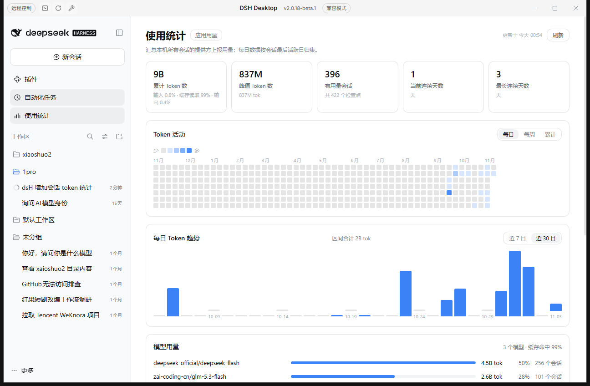

# dsh-usage-stats

All-session token usage dashboard for [DeepSeek Harness (DSH)](https://github.com/deepseek-ai/deepseek-harness): totals, peak session, streaks, activity heatmap, daily trend, per-model usage and a session ranking — computed locally from the profile's session projection cache.



## What it adds

A **Usage Statistics** entry in the sidebar (under Plugins / Automations) that opens a full-page dashboard:

| Section | Content |
|---|---|
| Cards | Total tokens, peak session, sessions with usage, current streak, longest streak |
| Token activity | 53-week heatmap, switchable between daily / weekly / cumulative; hover shows date, tokens, sessions, turns |
| Daily trend | 7-day / 30-day bars with range total; hover shows date, tokens, turns |
| Model usage | Tokens, share and session count grouped by `provider/model` |
| Session ranking | Top 200 sessions by tokens; click a row to open that session |

Numbers use compact formatting (`1.2k` / `344M` / `4.4B`).

## How it works

The Host half folds every checkpointed session row from the profile's projection cache:

```
<DSH_HOME>/storages/session_projcache/sessions/*.json
  → record.rows.tokenUsage.val.totals                 (uncached input / cache read / cache write / output)
  → record.rows.sessionStats.val.turns / .steps       (turns / steps)
  → record.rows.modelSelection.val                    (last used provider / model)
  → record.rows.sessionListMetadata.val.lastPromptAt  (last active time)
```

Reading the projection cache (rather than replaying session logs) means the dashboard also counts sessions that the session-list API does not serve to the browser, for example records written by an older session format version — their checkpoint rows are still on disk.

The summary is served to the page by one read-only route registered by this plugin:

```
GET /usage-stats/summary     → JSON (30 s in-memory cache)
```

- only **loopback peers** are accepted; any other peer gets `403`, so a LAN-exposed Web UI does not publish usage statistics;
- responses carry `cache-control: no-store`;
- the plugin never writes files and makes no outbound network requests.

## Install

Requires DSH `>=0.2.1-rc.1 <0.3.0` and Node `>=22.19`.

```bash
dsh plugin --profile desktop add "github:inezmitche46-maker/dsh-usage-stats#path:/packages/dsh-usage-stats"
```

Use `--profile web` on a Web profile. Restart DSH Desktop (or reload the page) after installing.

## Scope and limitations

- Daily buckets attribute a session's whole usage to its **last active local day** — exact for single-day sessions, approximate for sessions spanning days.
- Only sessions present in the projection cache are counted; a session that never checkpointed usage is not listed.
- The in-progress turn may lag one checkpoint behind; use the page's refresh button to re-read.

## Compatibility

- Tested against DSH `0.2.1-rc.2` (DSH Desktop Beta `2.0.18-beta.1`), Web surface.
- Client half registers into the `main` and `sidebar.panellist` slots and binds the `usage-stats` locale namespace (`zh` / `en`).
- Host half injects `webServer` and reads `profileContext.home` from the running DSH profile.

## Uninstall

```bash
dsh plugin --profile desktop remove dsh-usage-stats
```

## License

MIT
